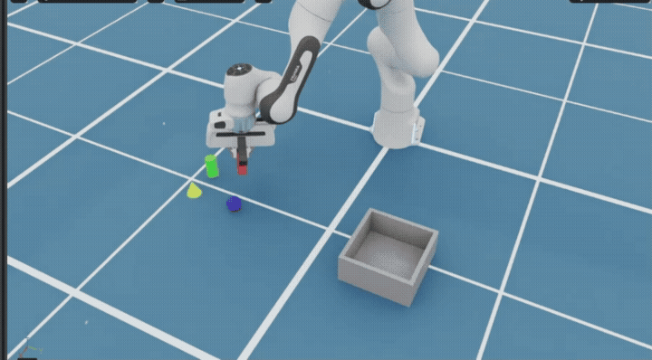
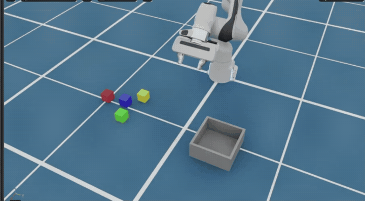

# Hybrid VLA Franka manipulation

An end-to-end embodied manipulation system built with Isaac Sim 6.1 and a
Franka Panda. It combines natural-language task planning, open-vocabulary RGB-D
perception, shape-aware grasping, continuous wrist visual servoing, bounded
failure recovery, and physics-based success verification.

The project also includes a reproducible LeRobot data pipeline for ACT and
language-conditioned SmolVLA, plus online DAgger correction collection. The
language model selects only locally validated skills; metric poses, joint
commands, safety gates, and task verification remain under deterministic local
control.

## Highlights

- Open-vocabulary 3-D instance perception using RGB-D geometry and CLIP.
- Shape-aware grasps for cuboids, spheres, cylinders, and cones.
- 10 Hz wrist RGB-D servoing with confidence, depth, and displacement gates.
- Seeded fault injection and paired statistical evaluation.
- Multiview RGB-D demonstrations, ACT/SmolVLA evaluation, and online DAgger.
- Typed LLM tool contracts, bounded recovery, and auditable execution traces.

| Reproducible result | Outcome |
|---|---:|
| Wrist calibration, 41 matched observations | mean XY error: 16.59 mm -> 0.87 mm |
| 30 matched mixed-fault scenarios | baseline: 40.0%; servo + recovery: 100.0% |
| Continuous-servo ablation, 30 scenarios | final command error: 1.95 mm -> 1.20 mm |
| Recovery-supervisor evaluation, 60 cases | 100% policy-valid decisions; 0 unsafe retries |

These results are scoped to the committed experiment configurations; individual
smoke tests are not presented as population-level success rates. See the small
reports in [`benchmark_results/`](benchmark_results/) and
[`llm_eval_results/`](llm_eval_results/).

## Demos

| End-to-end Hybrid VLA task | Dynamic-shift recovery |
|---|---|
| [](media/demos/hybrid_vla_full_task.mp4) | [](media/demos/visual_servo_recovery.mp4) |
| Natural-language plan to physics-verified placement of all four held-out objects | Object shifted ~60 mm mid-approach: re-observe, replan, and verified retry |

## Repository layout

```text
.
├── franka_color_sorting.py    # Isaac scene and manipulation state machine
├── agent_main.py              # natural-language / Hybrid VLA entry point
├── llm_agent/                 # plans, contracts, tools, and recovery
├── vision_localizer.py        # RGB-D perception and wrist tracking
├── grasp_geometry.py          # point-cloud grasp estimation
├── benchmark.py               # seeded benchmarks and fault injection
├── vla_dataset.py             # multimodal episode recorder
├── export_*_lerobot.py        # LeRobot dataset exporters
├── act_runtime.py             # ACT/SmolVLA inference bridge
├── tests/                     # simulator-independent unit tests
├── docs/                      # architecture documentation
└── benchmark_results/         # compact committed result summaries
```

See [Architecture](docs/ARCHITECTURE.md) for module boundaries and data flow.
Datasets, checkpoints, raw captures, logs, and full benchmark runs are excluded
from Git because the local working directory can exceed 80 GB.
Instructions for recording and embedding compact project demos are in the
[demo recording guide](media/README.md).

## Requirements

- NVIDIA Isaac Sim 6.1 for simulation and robot execution.
- Python 3.10 for the pinned LeRobot 0.4.4 training/inference environment.
- A CUDA-capable environment is recommended for CLIP and policy training.
- An OpenAI-compatible or DeepSeek API key is optional; deterministic offline
  planning works without a cloud service.

Install optional perception or VLA dependencies in system Python:

```bash
python3 -m pip install -r requirements-perception.txt
python3 -m pip install -r requirements-vla.txt
```

Copy `.env.example` to `.env` only when using a cloud planner. Never commit the
resulting `.env` file.

## Quick start

```bash
cd ~/isaacsim
./python.sh ~/franka_color_sorting/franka_color_sorting.py --target red
```

Examples:

```bash
# Put the blue block in the box.
./python.sh ~/franka_color_sorting/franka_color_sorting.py --target blue

# Categories: warm = red + yellow; cool = blue + green.
./python.sh ~/franka_color_sorting/franka_color_sorting.py --target warm

# Choose multiple explicit colors/categories.
./python.sh ~/franka_color_sorting/franka_color_sorting.py --target red cool
```

Color/category requests determine which blocks should be sorted. In RGB-D
mode, the arm's pickup position comes from camera segmentation and depth
unprojection, not from the scene's object pose; simulator poses are retained
only for collision-aware control feedback and final placement verification.

To run the RGB-D pickup path directly in one Isaac Sim process, add `--rgbd`.
It captures the overhead camera after the scene is initialized, estimates the
requested cubes from RGB plus depth, and refuses to move if any requested cube
is not detected (there is no silent simulator-pose fallback):

```bash
cd ~/isaacsim
./python.sh ~/franka_color_sorting/franka_color_sorting.py --target red cool --rgbd
```

### Generic RGB-D object perception

The original colour-threshold localizer remains available as
`--perception-backend color` for a matched baseline. The new generic path
does not use RGB colour masks to find objects:

1. calibrated RGB-D points are transformed into the world frame;
2. tabletop objects are proposed from height, workspace bounds, and connected
   3-D support;
3. each proposal is saved as an auditable crop;
4. local CLIP performs open-vocabulary crop-to-description matching with a
   global one-to-one assignment; and
5. low-confidence assignments are rejected before any motion starts.

During continuous wrist servoing, semantic inference is not repeated at
10 Hz. The already selected target is associated with the nearest valid 3-D
instance, which keeps the control loop local and bounded.

Run the complete generic-perception grasp path with:

```bash
cd ~/franka_color_sorting
~/isaacsim/python.sh franka_color_sorting.py \
  --target green --rgbd --headless --test \
  --perception-backend generic --semantic-backend clip
```

Descriptions are configurable without changing perception code. The keys are
the current scene/controller IDs, while the values are free-form visual
descriptions:

```bash
~/isaacsim/python.sh franka_color_sorting.py \
  --target red --rgbd \
  --perception-backend generic \
  --semantic-vocabulary configs/semantic_vocabulary.json
```

The semantic worker uses system Python because Isaac Sim's embedded Python
environment does not include PyTorch/Transformers. Install its optional
dependencies and cache the default model once before running offline:

```bash
python3 -m pip install -r requirements-perception.txt
python3 -c "from transformers import CLIPModel, CLIPProcessor; n='openai/clip-vit-base-patch32'; CLIPProcessor.from_pretrained(n); CLIPModel.from_pretrained(n)"
```

Every run records proposal crops, an annotated overlay, the vocabulary
manifest, the CLIP score matrix, accepted/rejected assignments, geometry
quality, and final poses in `<image_stem>_instances/`.
`--semantic-min-confidence` controls fail-safe
rejection (default `0.50`). `prototype` is a fast colour-based CI/ablation
classifier and `smolvlm` is experimental; neither is the default generic
backend.

Use matched seeds to compare the old and new perception stacks:

```bash
python3 benchmark.py --trials 20 --seed 42 \
  --perception-backend color \
  --output benchmark_results/perception_color_20
python3 benchmark.py --trials 20 --seed 42 \
  --perception-backend generic --semantic-backend clip \
  --output benchmark_results/perception_generic_clip_20
python3 compare_benchmarks.py \
  benchmark_results/perception_color_20 \
  benchmark_results/perception_generic_clip_20 \
  --labels "Colour masks" "RGB-D + CLIP" \
  --output benchmark_results/perception_ablation.md
```

The integration smoke test at master seed `42` detected 4/4 scene objects,
correctly selected `green`, completed the grasp and verified placement without
recovery, and reduced the selected target's XY command error from 1.34 mm to
0.77 mm with wrist feedback. Its artifacts are in
`benchmark_results/generic_perception_smoke_seed42_1/`. This one trial proves
the end-to-end integration, not a population-level robustness result.

### Held-out shapes and shape-aware grasping

The generic path includes disjoint `seen` and `heldout` primitive-object
splits. The held-out split contains a rotated thin cuboid, sphere, tall
cylinder, and cone. RGB-D point clouds estimate footprint dimensions, PCA yaw,
object height, jaw opening, and top-surface relief without consulting the
simulator pose. The controller rotates the top-down gripper to the estimated
minor-axis closing direction and refuses motion when the observed geometry has
no supported parallel-jaw top grasp.

Run one deterministic pass over all four held-out categories:

```bash
python3 benchmark.py --trials 4 --seed 20261016 \
  --target-policy cycle --min-targets 1 --max-targets 1 \
  --object-set heldout --perception-backend generic \
  --semantic-backend clip --wrist-mode servo \
  --output benchmark_results/heldout_shape_cycle_4
```

The benchmark reports task success separately from semantic detection,
geometry safety rejection, and success among trials where motion was allowed.
The original seed `20261016` run detected and labelled all four objects; its
2 mm planar-only gate placed the cuboid, sphere, and cylinder successfully but
rejected the tapered cone. The current controller extends the calibrated
caging-grasp envelope to 4 mm of surface relief, while retaining width, height,
confidence, and physics-based placement checks. Re-run the benchmark before
using four-shape success numbers in a report or resume.

The curved-object extension also models 1.5/1.2 static/dynamic-friction rubber
finger pads and packs held-out objects into four collision-free floor slots in
the 18 cm target box, since a sphere and cone do not form a stable vertical
stack. An end-to-end LLM-planned smoke run on 2026-10-17 placed the rotated
cuboid, sphere, tall cylinder, and cone in one task and received simulator
verification for all four. This is an integration result, not yet a randomized
population-level success-rate claim.

Rebuild the auditable held-out report from a saved run without launching Isaac
Sim or requiring a GPU:

```bash
python3 analyze_unseen_objects.py benchmark_results/heldout_shape_cycle_safe_4
```

### Isaac-to-LeRobot expert demonstrations

The task runner can record a successful classical-controller rollout as a
crash-tolerant raw VLA episode. At a configurable rate it stores overhead and
wrist RGB-D, joint position/velocity, end-effector pose, gripper width, the
expert joint-position command, controller phase, selected object, language
instruction, and simulator-only object poses for offline auditing. Simulator
truth is metadata and is never included in the exported VLA observation.

Record one held-out four-object demonstration at 10 Hz:

```bash
~/isaacsim/python.sh franka_color_sorting.py \
  --target all --rgbd --headless --test \
  --object-set heldout --perception-backend generic \
  --semantic-backend clip --wrist-mode servo \
  --record-dataset vla_datasets/franka_heldout_raw \
  --record-instruction "Place all four irregular objects in the target box" \
  --record-fps 10
```

Each run creates `episodes/episode_<index>/episode.json`, `frames.jsonl`, and
four synchronized image streams. Failed or interrupted runs remain labelled as
failed rather than being silently used for behavior cloning.

LeRobot is installed in system Python separately from Isaac's embedded Python.
Convert completed successful episodes into a local LeRobot v3 dataset with:

```bash
python3 -m pip install -r requirements-vla.txt
python3 export_lerobot.py \
  vla_datasets/franka_heldout_raw \
  vla_datasets/franka_heldout_lerobot \
  --repo-id local/franka-heldout
```

ACT currently requires all camera streams to share one shape. Create an
ACT-ready copy with aspect-ratio-preserving letterbox resize (the raw data is
left untouched):

```bash
python3 export_lerobot.py \
  vla_datasets/heldout_300_raw \
  vla_datasets/heldout_300_act_256 \
  --repo-id local/franka-heldout-300-act-256 \
  --image-size 256 256
```

Validate both the raw recordings and the converted LeRobot dataset before training:

```bash
python3 validate_vla_dataset.py \
  vla_datasets/franka_heldout_raw \
  --lerobot-root vla_datasets/franka_heldout_lerobot \
  --repo-id local/franka-heldout
```

Collect a reproducible randomized batch (each trial starts a clean Isaac Sim
process and retains its seed, scenario, log, and success/failure label):

```bash
python3 benchmark.py \
  --trials 10 --seed 20261017 --min-targets 4 --max-targets 4 \
  --object-set heldout --perception-backend generic --semantic-backend clip \
  --wrist-mode servo --record-fps 10 \
  --record-dataset vla_datasets/franka_heldout_raw \
  --record-instruction "Place all four irregular objects in the target box" \
  --output benchmark_results/vla_collection_seed20261017_10
```

If a long collection was interrupted, resume until the dataset contains an
exact number of finalized raw episodes. The command also writes a deterministic
episode-level 80/10/10 split after reaching the target:

```bash
python3 collect_vla_until.py \
  --raw-root vla_datasets/heldout_300_raw \
  --target-episodes 300 \
  --split-output vla_datasets/heldout_300_splits.json
```

Regenerate the split without launching Isaac:

```bash
python3 create_vla_splits.py vla_datasets/heldout_300_raw \
  --output vla_datasets/heldout_300_splits.json --seed 20261018
```

The exported features are `observation.images.overhead`,
`observation.images.wrist`, `observation.state`, `action`, `next.reward`, and
`next.done`, with the instruction supplied through LeRobot's required `task`
field. Raw metric depth is retained for future depth-conditioned policies but
is not fed to the RGB-only SmolVLA baseline.

### ACT evaluation and goal conditioning

Evaluate every saved ACT checkpoint on the validation split, select by the
unnormalized five-step action MAE, and evaluate the selected checkpoint once on
the held-out test split:

```bash
python3 evaluate_act_checkpoints.py \
  --checkpoint-root outputs/act_full_145_50k/checkpoints \
  --output outputs/act_full_145_50k/evaluation.json
```

The plain ACT policy does not consume LeRobot's `task` text. If demonstrations
use different object orders, visually similar observations therefore have
conflicting targets. Export goal-conditioned single-object segments before the
closed-loop policy training run:

```bash
python3 export_goal_lerobot.py \
  vla_datasets/heldout_300_raw \
  vla_datasets/heldout_300_goal_act_256 \
  --source-splits vla_datasets/heldout_300_splits.json \
  --output-splits vla_datasets/heldout_300_goal_splits.json
```

This appends a documented four-value target one-hot vector to the 26D robot
state and makes every contiguous selected-object skill a separate episode.
Segments inherit their parent trajectory's split, so frames from one raw
rollout cannot leak between training, validation, and test.

Isaac Sim 6.1 uses Python 3.12 while the pinned LeRobot training environment
uses Python 3.10. `--act-checkpoint` therefore runs inference in a local
Python 3.10 sidecar over a Unix socket instead of mixing incompatible Python
packages inside Kit:

```bash
~/isaacsim/python.sh franka_color_sorting.py \
  --target red --object-set heldout --test \
  --act-checkpoint outputs/act_goal_full_50k/checkpoints/050000/pretrained_model \
  --act-control-hz 5 --act-action-steps 5
```

The goal-conditioned checkpoint accepts `red`, `green`, `blue`, `yellow`, or
an ordered list of targets. All four held-out objects remain in the scene as
distractors; `--target` changes the four-value goal condition consumed by the
policy. Add `--headless` for unattended evaluation.

### SmolVLA language-conditioning evaluation

For a VLA experiment without target one-hot leakage, export the same
single-object segments with natural-language conditioning. This retains the
26D robot state and supplies the target only through LeRobot's `task` field:

```bash
python3 export_goal_lerobot.py \
  vla_datasets/heldout_300_raw \
  vla_datasets/heldout_300_language_vla_256 \
  --conditioning language \
  --source-splits vla_datasets/heldout_300_splits.json \
  --output-splits vla_datasets/heldout_300_language_splits.json
```

After training SmolVLA, run the paired counterfactual test on the held-out
split. It evaluates identical observations and flow-matching noise with the
correct instruction and with a cyclically replaced, always-wrong target:

```bash
python3 evaluate_vla_language_ablation.py \
  --checkpoint outputs/smolvla_language_full_30k/checkpoints/030000/pretrained_model \
  --batch-size 16 --num-workers 4
```

On the 72-episode/3,234-frame test split, the 30k checkpoint's five-step MAE
was `0.010455` with the correct instruction and `0.034241` with a wrong one
(`+227.50%`); paired prediction MAE was `0.029336`. The exact report is stored
in `outputs/smolvla_language_full_30k/language_ablation.json`.

Run the language-conditioned policy in Isaac with a reproducible flow-matching
seed. Omit `--headless` to watch the rollout in the desktop viewport:

```bash
~/isaacsim/python.sh franka_color_sorting.py \
  --target red --object-set heldout --test \
  --vla-checkpoint outputs/smolvla_language_full_30k/checkpoints/030000/pretrained_model \
  --act-control-hz 5 --act-action-steps 5 \
  --policy-seed 20261018 --act-timeout 180
```

The runtime auto-detects SmolVLA, sends both RGB observations, the 26D robot
state, and `Place the red irregular object in the target box` to a Python 3.10
inference sidecar, then applies safety-filtered 9D joint targets in Isaac. Use
`--vla-instruction` for a custom single-target instruction; the current model
was trained only on the four documented instruction templates, so paraphrases
are out of distribution.

For closed-loop diagnosis, retain a five-action maximum chunk but re-observe
after one action whenever the predicted chunk contains a large arm step or a
gripper transition:

```bash
python3 benchmark.py \
  --trials 4 --seed 20261024 --target-policy cycle \
  --min-targets 1 --max-targets 1 --object-set heldout \
  --vla-checkpoint outputs/smolvla_dagger_r1_35_finetune_10k/checkpoints/010000/pretrained_model \
  --act-action-steps 5 --act-adaptive-reobserve \
  --act-precision-action-steps 1 --act-telemetry-images-every 10 \
  --output benchmark_results/vla_r1_adaptive_diagnostic_4
```

Every trial writes `policy_telemetry.jsonl` with raw/filtered actions, chunk
selection reasons, end-effector position, and gripper width. The compact
`policy_rollout_summary.json` reports total and arm-step action-clipping rates, minimum
end-effector/target distance, maximum object lift/displacement, and a coarse
failure stage (`approach`, `contact_or_grasp`, `lift`, or
`transport_or_release`). RGB-D snapshots are opt-in because they consume much
more disk. `summary.json` aggregates failure-stage counts and clipping rate
across the benchmark. Simulator object poses are used only by diagnostics and
success verification; adaptive chunk selection itself uses only predicted
actions and robot state.

A matched one-scene diagnostic (`seed=3118414722`, held-out red object) found
that adaptive R1-10k still failed in `approach` after 120 simulation seconds
(minimum EEF-target distance 17.3 cm; no lift), whereas the generic RGB-D,
shape-aware, wrist-servo executor completed the same scene in 27.3 seconds
without recovery. This is bottleneck evidence rather than a success-rate
estimate; see `benchmark_results/adaptive_vs_hybrid_seed3118414722.md`.

Initial deployment diagnostics completed the full inference/control path but
achieved 0/3 physics-verified placements (red with five-step and one-step
re-observation, and blue with five-step re-observation). This negative result
is retained in `outputs/smolvla_language_full_30k/closed_loop_evaluation.json`;
offline action MAE and language sensitivity must not be reported as closed-loop
success. Corrective policy-visited-state data or DAgger-style fine-tuning is
the next model improvement.

### Online DAgger correction loop

`--dagger-dataset` runs SmolVLA online while a local RGB-D, CLIP-associated,
shape-aware controller labels the same policy-visited states. The executed
joint target is a teacher/student mixture controlled by `--dagger-beta`; an
arm-action disagreement above `--dagger-intervention-threshold` switches to
the full teacher action. Every raw frame retains the teacher label, student
proposal, executed action, intervention reason, phase, RGB-D observations, and
robot state for auditing. The simulator's object poses are used only for
physics verification, not as teacher perception input.

Collect one correction rollout (remove `--headless` to watch it):

```bash
~/isaacsim/python.sh franka_color_sorting.py \
  --target yellow --object-set heldout \
  --perception-backend generic --semantic-backend clip --test \
  --vla-checkpoint outputs/smolvla_language_full_30k/checkpoints/030000/pretrained_model \
  --dagger-dataset vla_datasets/dagger_round1_raw \
  --dagger-round 1 --dagger-beta 0.8 \
  --dagger-intervention-threshold 0.75 \
  --act-control-hz 5 --act-action-steps 5 --act-timeout 120 \
  --policy-seed 20261022 --headless
```

Collect a balanced, randomized, resumable batch. Each accepted trajectory
starts a fresh Isaac Sim process and randomizes collision-free object poses,
the overhead camera, lighting, target instruction, and policy seed:

```bash
python3 collect_dagger.py \
  --raw-root vla_datasets/dagger_round1_raw \
  --count 30 --seed 2026101901 \
  --output benchmark_results/dagger_round1_random_30_seed2026101901 \
  --checkpoint outputs/smolvla_language_full_30k/checkpoints/030000/pretrained_model \
  --dagger-round 1 --dagger-beta 0.8 \
  --intervention-threshold 0.75
```

For a targeted second round, exact per-target quotas can be supplied. Empty
perception attempts are retained for audit but retried and do not consume the
requested count:

```bash
python3 collect_dagger.py \
  --raw-root vla_datasets/dagger_round2_targeted_raw \
  --count 40 --target-counts yellow=15,green=12,blue=8,red=5 \
  --seed 2026102301 \
  --output benchmark_results/dagger_round2_targeted_40_seed2026102301_v2 \
  --checkpoint outputs/smolvla_dagger_r1_35_finetune_10k/checkpoints/010000/pretrained_model \
  --dagger-round 2 --dagger-beta 0.5 \
  --intervention-threshold 0.75
```

When audit directories include a finalized zero-frame rejected attempt, use
`python3 validate_vla_dataset.py DATASET --skip-empty`; strict validation
remains the default.

The formal round-2 run completed 40/40 trainable trajectories in 41 attempts:
21 successful and 19 failed-policy correction rollouts, with exact target
counts red/blue/green/yellow = 5/8/12/15. Deep validation found 975 complete
RGB-D frames; 973 have valid shadow-expert labels and the exporter deliberately
filters the two unlabeled terminal boundary frames. The report is
`benchmark_results/dagger_round2_targeted_40_seed2026102301_v2/summary.json`.

The first formal randomized batch completed 30/30 trajectories without an
infrastructure retry: 26 successful and 4 failed rollouts, with 810/810 frames
carrying valid RGB-D shadow-expert labels and no missing image/depth files.
The target distribution is red/blue/green/yellow = 8/8/7/7; per-target
success is 8/8, 8/8, 7/7, and 3/7 respectively. Failed yellow rollouts remain
in the correction set because they expose the policy's hardest visited states.
The machine-readable report is
`benchmark_results/dagger_round1_random_30_seed2026101901/summary.json`.

Validate the raw data, then rebuild a leakage-safe aggregate LeRobot dataset:

```bash
python3 validate_vla_dataset.py vla_datasets/dagger_round1_raw

python3 export_dagger_lerobot.py \
  vla_datasets/heldout_300_raw \
  vla_datasets/heldout_300_language_dagger_r1_256 \
  --dagger-root vla_datasets/dagger_round1_raw \
  --source-splits vla_datasets/heldout_300_splits.json \
  --output-splits vla_datasets/heldout_300_language_dagger_r1_splits.json
```

Failed rollouts are intentionally retained because they contain the states
where the student drifts. The exporter removes frames without a valid teacher
action and places every correction episode in the training split; the original
validation and test parents remain unchanged. The round-1 pipeline acceptance
set contains 5 rollouts (4 successful), 133 valid correction frames, and
produces 729 episodes / 32,566 frames with train/validation/test counts of
585/72/72. This small seed set validates the loop; collect a larger randomized
round before claiming a policy improvement, then compare the fine-tuned model
against the untouched 72-episode test split and a physics-verified Isaac
closed-loop benchmark.

Fine-tuning can assign an exact 50% sampling probability to correction frames
even when they are much fewer than base demonstrations. The wrapper builds a
frame-level `WeightedRandomSampler` from the export manifest and leaves
validation/test data unchanged:

```bash
python3 train_smolvla_dagger.py \
  --dataset-root vla_datasets/heldout_300_language_dagger_r2_256 \
  --repo-id local/franka-color-sorting-dagger-r2 \
  --splits vla_datasets/heldout_300_language_dagger_r2_splits.json \
  --output outputs/smolvla_dagger_r2_weighted \
  --checkpoint outputs/smolvla_dagger_r1_35_finetune_10k/checkpoints/010000/pretrained_model \
  --dagger-manifest vla_datasets/heldout_300_language_dagger_r2_256/segment_manifest.json \
  --dagger-fraction 0.5
```

In the round-2 experiment, validation selected the 8k checkpoint, but the
50/50-weighted model degraded untouched test 5-step action MAE from 0.010843
(round-1 10k) to 0.015049. A matched eight-scenario Isaac benchmark also
favoured round-1 10k: 1/8 versus 0/8 physics-verified placements. The sample is
too small for statistical significance (exact McNemar p=1.0), so this is a
negative ablation result rather than proof of superiority; round-1 10k remains
the deployment checkpoint. See
`benchmark_results/paired_vla_r1_vs_r2_8_seed20261024.md`.

For accuracy-first demonstrations, use the hierarchical VLA preset. Language
selects and orders targets, while fresh generic RGB-D instance perception,
CLIP association, shape-aware grasp generation, continuous wrist visual servo,
and physics verification provide the metric execution layer:

```bash
python3 agent_main.py "把四个不规则物体全部放进目标箱" \
  --offline --precise
```

`--precise` expands to a persistent Isaac scene with `heldout` irregular
objects, the `generic` perception backend, and the `clip` semantic backend.
The persistent scene matters: each object is re-observed immediately before
its pick, so contact-induced motion cannot be hidden by resetting the scene or
reusing stale poses. Remove `--offline` to use the configured vision-language
cloud planner while keeping the same locally verified execution boundary.

The cloud `--precise` path is the strict Hybrid VLA mode. It sends labelled
overhead and calibrated wrist RGB observations together with the instruction
to the visual-language planner. The planner must return an
`execute_hybrid_vla_plan` call whose locally validated steps contain
`object_id`, `skill`, `start_phase`, `grasp_strategy`, destination, and order.
Only `pick_and_place`, `localize`, `shape_aware`, and `target_box` are currently
permitted; metric poses and joint commands can never be supplied by the model.
For example:

```bash
python3 agent_main.py "先抓红色，再抓蓝色并放进目标箱" \
  --precise \
  --trace-output observations/hybrid_vla_trace.json
```

Every pick produces structured phase events for localization, grasp generation,
and physics verification. A failed grasp or placement is converted into trusted
feedback containing the object, failure code, current phase, completed objects,
and remaining retry budget. The recovery VLA receives this feedback plus fresh
overhead/wrist images and may choose only re-observe, retry, skip a verified
completed object, or abort. Retrying causes fresh RGB-D localization and a new
shape-aware grasp angle; completed objects are preserved. The JSON trace stores
visual input paths, validated skill calls, phase events, recovery supervision,
and final verified state.

`--offline --precise` uses the same Hybrid executor and structured skill
contract, but its language parser is deterministic and does not itself inspect
the images. Use the cloud command above when claiming visual-language planning;
use offline mode as a reproducible execution ablation.

The end-to-end acceptance run with the configured `deepseek-flash` planner
successfully consumed both camera views, emitted a validated Hybrid VLA skill,
and physics-verified one held-out red object in the target box. Four wrist
servo corrections were accepted and three out-of-gate corrections were safely
rejected. This is a functional single-scene check, not a randomized success
rate; see `outputs/hybrid_vla_acceptance.md` and
`observations/hybrid_vla_cloud_acceptance.json`.

The initial deterministic-scene acceptance test completed 3/3 tasks and 6/6
requested object placements, including one continuous four-object run. These
are acceptance results rather than a randomized benchmark; the structured
report is `outputs/smolvla_language_full_30k/precise_closed_loop_evaluation.json`.

## Natural-language agent

`agent_main.py` adds a strictly bounded language layer above the verified
controller. The model sees text state only and may call only
`get_scene_state` and `execute_sort_plan`. The latter accepts an ordered,
strictly validated plan with object IDs, stack levels, a low-confidence policy,
and at most one retry. Tool arguments are schema-checked
locally and simulator pose checks remain the authority for success.

With a cloud planner, the default path first launches a matching Isaac Sim
scene long enough to capture `observations/latest_overhead.png` from a fixed,
calibrated overhead RGB camera. That image—not object pose data—is sent to
DeepSeek as vision input. The model uses it to identify colors and relative
layout; local code retains responsibility for metric coordinates, collision
avoidance, and success verification. Add `--no-vision` only for API/debugging
tests that should skip image capture.

That same capture also writes
`observations/latest_vision_poses.json`. `vision_localizer.py` estimates each
cube centre from RGB colour segmentation plus depth unprojection using the
camera calibration. The task launcher passes those local estimates to the FSM
only during pre-grasp/approach/grasp; physics truth remains restricted to
drop/success evaluation.

### Continuous wrist RGB-D visual servo

An RGB-D camera is rigidly mounted on the side/upper rear of Franka's
end-effector. Its fixed hand-eye transform is expressed in the tool frame, so
both translation and orientation follow the wrist without target-facing
`look_at` motion. The visible D455 housing is a child of `panda_hand`; the
renderer camera is synchronized from the same calibrated transform before
each frame because Isaac's camera unprojection reads USD rather than Fabric
articulation transforms. This avoids intermittent vendor-USD updates in the
viewport while keeping RGB-D and world points aligned. During
`PRE_GRASP` and `APPROACH`, it now closes the perception-control loop instead
of applying one discrete correction:

- tracks the selected block every simulation frame and samples RGB-D at 10 Hz;
- accepts observations only inside the calibrated 0.19–0.30 m viewing range;
- applies confidence, coverage, depth-consistency, and displacement gates;
- anchors the displacement gate to the original overhead observation, limiting
  total normal-run drift to 12 mm instead of allowing small errors to accumulate;
- rejects outliers with a three-frame median, then applies an EMA; and
- limits each XYZ command update to 8 mm and freezes the last trusted target
  when the camera becomes too close or perception is rejected.

The rate, filter gain, and correction bound are reproducible CLI parameters:

```bash
python3 benchmark.py --trials 20 --seed 42 \
  --visual-servo-rate-hz 10 \
  --visual-servo-alpha 0.7 \
  --visual-servo-max-step-mm 8
```

Use `--wrist-mode off`, `single`, or `servo` for a matched ablation. `single`
uses the same gate, filter, and 8 mm step bound as `servo`, but permits only
one accepted correction per target; this isolates the value of repeated
feedback rather than changing multiple algorithm components at once.

Every wrist frame and pose is saved as
`wrist_<color>_servo_<sample>.*`; accepted control updates are recorded in
`visual_servo_trace.jsonl`. The benchmark reports update count, initial and
final command error, and error improvement.

Use the standalone capture command to inspect the camera calibration:

```bash
~/isaacsim/python.sh ~/franka_color_sorting/franka_color_sorting.py \
  --wrist-capture-path ~/franka_color_sorting/observations/latest_wrist.png
```

This writes `latest_wrist.png` and `latest_wrist_poses.json`.

On the reproducible edge-of-frame seed `939042955`, overhead-only control
failed with 22.15 mm target error. Continuous wrist servo accepted five
bounded updates, reduced the final command error to 1.08 mm, and completed the
first grasp without invoking recovery. See
`benchmark_results/continuous_servo_seed939042955_comparison.md`. A separate
three-scene smoke run completed 3/3 tasks (four objects), applying 24 accepted
updates and ending at 0.64 mm mean target error. These small runs validate the
integration but are not a population-level success-rate claim.

First smoke-test the full tool boundary without moving the robot:

```bash
cd ~/franka_color_sorting
python3 agent_main.py "把暖色方块堆进盒子" --offline --dry-run
```

Remove `--dry-run` to execute the verified GUI simulator task:

```bash
python3 agent_main.py "put the red and blue blocks in the box" --offline
```

The offline mode makes the same explicit plan every time. The cloud mode can
choose the permitted task based on the user instruction and return a final
explanation after the simulator's verified success or failure result. Each task
is limited to two physical attempts and planning is limited to eight turns.

For cloud tool calling, copy `.env.example` to `.env`, select `LLM_PROVIDER`,
and configure that provider's key. For DeepSeek, the minimum configuration is:

```dotenv
LLM_PROVIDER=deepseek
DEEPSEEK_API_KEY=your_key_here
DEEPSEEK_MODEL=deepseek-flash
```

Then run the same command without `--offline`. The agent sends tool results
back to the model after each call, limits physical attempts to two, and limits
planning to five turns. Keep `.env` private.

### LLM planning evaluation

The language layer compiles instructions into a strict ordered `TaskPlan`;
the LLM never supplies world coordinates or joint commands. A deterministic
100-case bilingual eval covers direct targets, color groups, explicit order,
exclusions, spatial relations, ambiguity, impossible objects, and attempts to
bypass the controller.

Run the rule-based baseline without an API key:

```bash
python3 llm_eval.py \
  --provider offline \
  --output llm_eval_results/offline_100
```

Evaluate the cloud provider configured in `.env` without moving the robot:

```bash
python3 llm_eval.py \
  --provider configured \
  --output llm_eval_results/cloud_100
```

For a low-cost smoke test covering every category first:

```bash
python3 llm_eval.py \
  --provider configured \
  --per-category 2 \
  --output llm_eval_results/cloud_smoke_12
```

The evaluator returns synthetic tool results but executes no physical action.
It records every tool trace and reports exact-plan accuracy, safe rejection,
observe-before-action compliance, schema validity, latency, and token usage. Results are
checkpointed after every case. If a provider is temporarily unavailable, the
run stops after two consecutive API errors and can be continued without
repeating completed calls:

```bash
python3 llm_eval.py \
  --provider configured \
  --per-category 2 \
  --output llm_eval_results/cloud_smoke_12 \
  --resume
```

### Failure-aware LLM recovery supervisor

After a failed `execute_sort_plan`, the agent now converts the tool result into
a typed `ExecutionFeedback` record containing the failed phase, normalized
failure code, perception confidence, completed and remaining objects, whether
a fresh observation exists, the user-selected low-confidence policy, and the
remaining retry budget. Raw simulator logs are deliberately excluded from the
model context so text in an untrusted tool result cannot become an instruction.

The recovery supervisor must select exactly one schema-constrained action:
`continue`, `reobserve`, `retry`, `skip_completed`, or `abort`. A deterministic
local transition validator then rejects attempts to retry without a fresh
observation, retry an unknown failure, repeat a completed object, discard
completed work, exceed the retry budget, or override
`on_low_confidence=abort`. The LLM never supplies poses, trajectories, or joint
commands.

Run the integrated agent in a persistent physics scene with the configured LLM
supervisor:

```bash
python3 agent_main.py "把暖色方块放进盒子" \
  --persistent-sim --recovery-supervisor llm
```

Use `--recovery-supervisor rule` for the deterministic reference policy or
`off` for an ablation. `auto` (the default) selects the LLM for cloud planning
and rules for offline operation.

The dedicated 60-case evaluation covers successful completion, stale motion,
sensor degradation, re-observation before retry, user-requested abort,
exhausted budgets, already-completed objects, and unknown/untrusted failures:

```bash
python3 llm_recovery_eval.py --provider offline \
  --output llm_eval_results/recovery_rule_60
python3 llm_recovery_eval.py --provider configured \
  --output llm_eval_results/recovery_cloud_60
python3 analyze_llm_recovery.py \
  llm_eval_results/recovery_rule_60 \
  llm_eval_results/recovery_cloud_60 \
  --labels "Rule reference" "LLM supervisor" \
  --output llm_eval_results/recovery_supervisor_formal_60.md
```

In the formal DeepSeek run, both the rule reference and LLM achieved 60/60
exact action-plus-reason decisions with zero unsafe retries. The LLM averaged
1.72 seconds per decision and consumed 72,284 tokens in total, while the local
rule policy was effectively instantaneous. This result demonstrates safe
behavioral equivalence on the deterministic suite, not that the LLM is faster
or more reliable than rules. The full report is in
`llm_eval_results/recovery_supervisor_formal_60.md`.

## Validation

The controller checks the actual rigid-block pose after every phase; it does
not claim success merely because the end effector reached its target. To run
the finite test loop without the desktop viewport:

```bash
cd ~/isaacsim
./python.sh ~/franka_color_sorting/franka_color_sorting.py --target red --headless --test
```

### Closed-loop failure recovery

The one-shot controller permits at most one autonomous recovery attempt by
default. If physics detects a missed grasp, slip, or failed placement, it:

1. opens the gripper and retreats to a camera-clear pose;
2. re-centres the overhead camera from the previous visual estimate and
   captures a fresh RGB-D frame;
3. excludes targets already verified inside the box, rebuilds the controller,
   and retries the remaining target once; and
4. accepts success only after a new physics-based placement check.

The retry pickup coordinate comes from the fresh RGB-D observation. Simulator
object poses are not used as a perception fallback. Set
`--max-recovery-attempts 0` for an ablation, or `1` (the default) to enable the
bounded recovery loop.

The edge-of-frame failure at trial seed `939042955` is a reproducible example:

```bash
# Fails after the first grasp attempt.
python3 benchmark.py --trials 1 --trial-seed 939042955 \
  --disable-wrist-refinement --max-recovery-attempts 0 \
  --output benchmark_results/recovery_disabled_seed939042955

# Safe retreat + focused RGB-D re-observation + one retry succeeds.
python3 benchmark.py --trials 1 --trial-seed 939042955 \
  --disable-wrist-refinement --max-recovery-attempts 1 \
  --output benchmark_results/recovery_focused_seed939042955
```

The matched artifact is
`benchmark_results/recovery_closed_loop_seed939042955.md`: recovery changes
this exact scene from 0/1 to 1/1 success, with one attempted and one successful
recovery. This single replay is an integration test, not a population-level
success-rate claim.

## Randomized benchmark

`benchmark.py` runs every trial in a fresh Isaac Sim process and randomizes
collision-free cube positions, requested target combinations, overhead-camera
pose, and dome-light intensity. It writes each scenario and simulator log plus
incremental `results.csv`, `results.json`, and `summary.json` files.

Generate scenarios without starting Isaac Sim:

```bash
cd ~/franka_color_sorting
python3 benchmark.py --trials 20 --seed 42 --generate-only
```

Run the full RGB-D manipulation benchmark:

```bash
python3 benchmark.py --trials 20 --seed 42
```

For a perception/control ablation without wrist feedback:

```bash
python3 benchmark.py --trials 20 --seed 42 --wrist-mode off
```

Use the same seed for matched runs, then generate a comparison table:

```bash
python3 compare_benchmarks.py \
  benchmark_results/gated_wrist_20 \
  benchmark_results/overhead_only_20 \
  --labels "Gated wrist" "Overhead only" \
  --output benchmark_results/ablation.md
```

The summary reports task success rate, duration, detection rate, recovery
events/attempts/successes, mean/RMSE/P95/maximum localization errors for both
overhead and wrist RGB-D, and visual-servo command convergence. Results are stored under
`benchmark_results/run_<UTC timestamp>/`; the manifest records every per-trial
seed so any failed scene can be reproduced exactly.

### Fault-injection robustness benchmark

The benchmark can also apply deterministic, fully recorded faults without
giving simulator truth to perception or control:

- `pose_bias`: 20--40 mm bias in the initial overhead RGB-D estimate;
- `dynamic_shift`: a selected object moves 20--38 mm during approach;
- `sensor_degradation`: 15--30 mm initial bias plus wrist-frame dropout and
  Gaussian depth/position noise.

`mixed` cycles evenly through all three types (30 trials gives 10 of each).
Use the same seed to compare open-loop control, continuous visual servo, and
servo with one closed-loop recovery attempt:

```bash
python3 benchmark.py --trials 30 --seed 20261016 --fault-profile mixed \
  --wrist-mode off --max-recovery-attempts 0 \
  --output benchmark_results/fault_baseline_30
python3 benchmark.py --trials 30 --seed 20261016 --fault-profile mixed \
  --wrist-mode servo --max-recovery-attempts 0 \
  --output benchmark_results/fault_servo_30
python3 benchmark.py --trials 30 --seed 20261016 --fault-profile mixed \
  --wrist-mode servo --max-recovery-attempts 1 \
  --output benchmark_results/fault_servo_recovery_30

python3 analyze_fault_benchmark.py \
  benchmark_results/fault_baseline_30 \
  benchmark_results/fault_servo_30 \
  benchmark_results/fault_servo_recovery_30 \
  --labels "Baseline" "Servo only" "Servo + recovery" \
  --output benchmark_results/fault_comparison_30.md
```

GPU/driver and asset-root startup failures are labelled
`infrastructure_error`, excluded from robot success statistics, and stop the
run immediately. The analyzer also rejects incomplete or infrastructure-failed
runs, preventing invalid matched comparisons.

#### Formal fault benchmark (`seed=20261016`)

The included formal report covers 30 matched scenarios (10 per fault type,
48 requested-object placements):

| Mode | Final success (95% Wilson CI) | Mean / median time | Recovery |
|---|---:|---:|---:|
| Baseline | 12/30, 40.0% (24.6--57.7%) | 26.30 / 23.89 s | disabled |
| Continuous servo | 20/30, 66.7% (48.8--80.8%) | 31.82 / 32.59 s | disabled |
| Servo + recovery | 30/30, 100.0% (88.6--100%) | 37.19 / 36.36 s | 11/11 recovered |

Continuous servo improved matched success over baseline (`p=0.0386`, exact
McNemar). Adding one closed-loop re-observation/replan attempt improved success
over servo-only by another 10/30 trials (`p=0.0020`); all 11 invoked recovery
attempts succeeded. Dynamic-shift success was 3/10, 2/10, and 10/10
respectively, showing that recovery—not servo alone—is the important component
for disturbances that occur after the initial observation. The latency cost is
also reported: recovery mode added 5.38 s to mean trial time versus servo-only.

See `benchmark_results/formal_fault_seed20261016_comparison_30.md` for the
complete paired table. Fault-event totals count frame-level dropout/noise
events, so they intentionally differ between modes with different numbers of
wrist-camera frames.

### Formal continuous visual-servo ablation

A 30-scenario matched benchmark (`seed=42`, 41 requested objects) disables
post-failure recovery to isolate wrist feedback. Every mode uses identical
object layouts, target order, camera pose, lighting, controller, and initial
overhead RGB-D estimates:

| Mode | Success | Mean successful time | Accepted updates | Initial XY error | Final XY error |
|---|---:|---:|---:|---:|---:|
| Overhead only | 29/30 (96.7%) | 27.39 s | 0 | 1.95 mm | 1.95 mm |
| Single update | 30/30 (100.0%) | 28.58 s | 40 | 1.95 mm | 2.06 mm |
| Continuous servo | 30/30 (100.0%) | 27.00 s | 229 | 1.95 mm | 1.20 mm |

Single-frame feedback slightly worsened mean terminal error by 0.11 mm.
Continuous servo improved it by 0.76 mm and produced lower terminal error than
overhead-only control on 29/41 matched objects versus 12/41 in the opposite
direction (`p=0.0115`, two-sided exact sign test). Task-success differences
are not statistically significant (`p=1.0`, exact McNemar), so the supported
claim is improved positioning precision—not a proven population-level success
increase. Recovery attempts were zero in all modes.

The complete table and generated SVG convergence plot are in
`benchmark_results/formal_seed42_visual_servo_ablation_30.md`. Rebuild them
with:

```bash
python3 analyze_visual_servo.py \
  benchmark_results/postcal_formal_seed42_overhead_only_30 \
  benchmark_results/formal_seed42_wrist_single_30 \
  benchmark_results/formal_seed42_continuous_servo_30 \
  --labels "Overhead only" "Single update" "Continuous servo" \
  --output benchmark_results/formal_seed42_visual_servo_ablation_30.md
```

### Historical wrist calibration benchmark

A 30-scenario matched benchmark (`seed=42`) compares identical object layouts,
target order, camera poses, and lighting across three wrist-refinement modes:

| Mode | Success | 95% CI | Successful-trial time | Recovery events |
|---|---:|---:|---:|---:|
| Gated wrist | 29/30 (96.7%) | 83.3%–99.4% | 31.82 s | 1 |
| Overhead only | 29/30 (96.7%) | 83.3%–99.4% | 26.26 s | 1 |
| Ungated wrist | 22/30 (73.3%) | 55.6%–85.8% | 26.99 s | 8 |

All modes detected all four objects in every trial. The wrist estimates had
roughly 17 mm mean XY error: accepting them unconditionally caused seven net
additional failures, while the quality/displacement gate rejected all 41
unsafe corrections and preserved the overhead-only success rate. The matched
exact McNemar test for gated versus ungated outcomes is `p=0.0391`. This result
supports the safety gate; it does not claim that the current wrist calibration
improves on the overhead-only baseline. See
`benchmark_results/formal_seed42_ablation_30.md` for the full comparison.

Before continuous servoing was added, correcting the wrist observation
distance and replacing camera-depth
quantile selection with world-height top-surface fitting, the repeated
30-scenario benchmark reduced mean wrist XY error from 16.59 mm to 0.87 mm
(P95 1.41 mm). Calibrated gated wrist succeeded in 30/30 scenes versus 29/30
for overhead-only, accepting 40 corrections, conservatively rejecting one,
and recovering the scene with a 22.15 mm overhead error. The one-case task
success difference is not statistically significant (exact McNemar `p=1.0`),
whereas all 41 matched wrist observations improved (`p<1e-12`, exact sign
test). See `benchmark_results/postcal_formal_seed42_comparison_30.md`.

Generate a signed calibration-error report from any runs with:

```bash
python3 analyze_wrist_calibration.py \
  benchmark_results/formal_seed42_gated_wrist_30 \
  benchmark_results/postcal_formal_seed42_gated_wrist_30 \
  --labels "Before calibration" "After calibration" \
  --output benchmark_results/wrist_calibration_before_after.md
```
