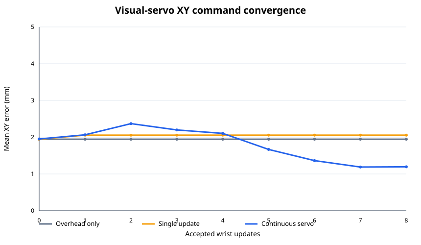

# Matched visual-servo ablation

Matched scenarios: 30

| Metric | Overhead only | Single update | Continuous servo |
|---|---:|---:|---:|
| Success | 29/30 (96.7%) | 30/30 (100.0%) | 30/30 (100.0%) |
| Mean successful duration | 27.39 s | 28.58 s | 27.00 s |
| Accepted wrist updates | 0 | 40 | 229 |
| Rejected wrist observations | 0 | 137 | 151 |
| Initial command XY error | 1.95 mm | 1.95 mm | 1.95 mm |
| Final command XY error | 1.95 mm | 2.06 mm | 1.20 mm |
| XY improvement | 0.00 mm | -0.11 mm | 0.76 mm |
| Recovery attempts | 0 | 0 | 0 |

## Paired outcome analysis

| Comparison | First only | Second only | Exact McNemar p |
|---|---:|---:|---:|
| Overhead only vs Single update | 0 | 1 | 1.0000 |
| Overhead only vs Continuous servo | 0 | 1 | 1.0000 |
| Single update vs Continuous servo | 0 | 0 | 1.0000 |

## Paired terminal-error analysis

| Comparison | First lower | Second lower | Ties | Mean second-vs-first improvement | Exact sign p |
|---|---:|---:|---:|---:|---:|
| Overhead only vs Single update | 25 | 16 | 0 | -0.11 mm | 0.211 |
| Overhead only vs Continuous servo | 12 | 29 | 0 | 0.75 mm | 0.01151 |
| Single update vs Continuous servo | 14 | 27 | 0 | 0.86 mm | 0.05958 |

Curves use last-observation-carried-forward after a mode stops updating, so every target retains equal weight at every update index.
Simulator object poses are used only for offline error scoring, never as controller input.
