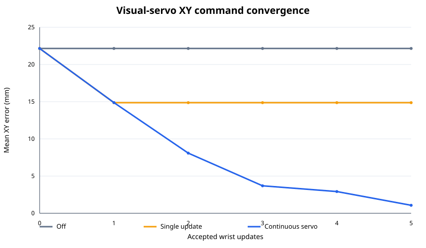

# Matched visual-servo ablation

Matched scenarios: 1

| Metric | Off | Single update | Continuous servo |
|---|---:|---:|---:|
| Success | 0/1 (0.0%) | 1/1 (100.0%) | 1/1 (100.0%) |
| Mean successful duration | — s | 29.95 s | 24.25 s |
| Accepted wrist updates | 0 | 1 | 5 |
| Rejected wrist observations | 0 | 2 | 4 |
| Initial command XY error | — mm | 22.15 mm | 22.15 mm |
| Final command XY error | — mm | 14.87 mm | 1.08 mm |
| XY improvement | — mm | 7.29 mm | 21.08 mm |
| Recovery attempts | 0 | 0 | 0 |

## Paired outcome analysis

| Comparison | First only | Second only | Exact McNemar p |
|---|---:|---:|---:|
| Off vs Single update | 0 | 1 | 1.0000 |
| Off vs Continuous servo | 0 | 1 | 1.0000 |
| Single update vs Continuous servo | 0 | 0 | 1.0000 |

Curves use last-observation-carried-forward after a mode stops updating, so every target retains equal weight at every update index.
Simulator object poses are used only for offline error scoring, never as controller input.
